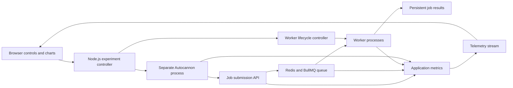

# Queue and Worker Playground

**Status: proposed showcase option; not implemented or benchmarked.** This learner-proposed project extends the worker-recovery lab with a UI, real HTTP load, queue telemetry and repeatable experiments. It is a candidate for the existing single showcase slot alongside the document assistant and LLM gateway. Selecting it replaces that slot's scope; it does not add another mandatory project or increase the weekly budget. Keep the separate AI evaluation lab.

## What a visitor should be able to demonstrate

Submit synthetic jobs, observe them waiting and running, increase offered load, change worker capacity, trigger a controlled worker failure, and compare the results. The UI should make it possible to explain when a queue absorbs a burst, when sustained overload grows a backlog, and when another bottleneck limits the benefit of adding workers.

Use real queue operations and independently running worker processes with clearly labeled synthetic work. Display measured values and visibly distinguish estimates or replayed results. Local experiments demonstrate behavior on the stated hardware and workload; claims about production or multi-host scale require separate evidence.

## Proposed architecture

JavaScript/Node.js is the proposed runtime, with a small React UI, Redis/BullMQ, a persistent result store and a local reproducible setup. Confirm specific libraries and versions when implementation starts. Autocannon runs in a separate Node.js process; the browser controls the experiment and displays results. The load runner and service still compete for hardware if hosted on the same machine, so record resource limits and topology.

## First version

- One job type with a documented result and workload. Start with a small transformation plus a configurable simulated I/O delay; label the delay explicitly. Add a bounded CPU-work variant later to compare behavior.
- Submit a job and inspect its lifecycle and durable result. A successful submission acknowledges queue admission; job completion is measured separately.
- Experiment controls for requested load, connections, duration, worker-process count, per-worker concurrency, and start/stop. Initially compare saved fixed-configuration runs; live ramps can follow once measurement is reliable.
- A worker view showing identity, active work, recent completions and failed/retried attempts; queue counts and job timelines driven by telemetry.
- Controlled failure scenarios: terminate a worker, pause/resume a worker around takeover, and inject a known job failure. Run deterministic correctness tests separately from throughput tests.
- Bound admitted backlog and report overload rejection explicitly. Limit run duration and load to the configured local service; do not expose an arbitrary-target load generator in a public demo. A hosted demo can show saved, clearly labeled results with the live runner available locally.
- Export run configuration, environment details and measured results so the same experiment can be repeated from the CLI.

Keep the initial UI to controls, charts and a small sample of job events. Aggregate/bound telemetry instead of trying to animate every job at high load. Record whether dashboard streaming was enabled in each benchmark.

## Measurements

| Measure | Meaning |
| --- | --- |
| Requested, generated and admitted load | Distinguish the configured target, requests actually generated and unique jobs durably accepted per second. Count rejections, HTTP errors and timeouts separately. |
| Completed work | Unique logical jobs successfully completed per second. Retries are attempts, not additional successful jobs. |
| Queue state | Waiting, active and delayed/retrying work, terminal failures and age of the oldest waiting job. Keep state definitions and sampling interval explicit. |
| Queue wait | Time between admission and starting processing; distinguish first start from later attempts. |
| Processing time | Per-attempt service duration, with retries and failures visible. |
| End-to-end completion latency | Admission to successful completion for a logical job, including waiting and retries. Show p50/p95/p99 when supported by enough samples, with sample size; separately report failed and unfinished jobs. |
| HTTP response latency | Time to acknowledge or reject submission. Never present it as end-to-end processing latency. |
| Resources and correctness | CPU/memory for runner, API and workers where measured, relevant queue/store metrics, invalid results, duplicate publications and stale-write rejection evidence. |

Give each experiment a run ID and jobs stable IDs. Stop generating new requests at the deadline, then track the admitted cohort through a bounded drain period. At cutoff, account for every admitted job as completed, terminally failed, or still pending/active/retrying. Reconcile ambiguous submissions separately instead of silently discarding them. Report offered-load and drain durations separately; unfinished jobs must not disappear from a success-only latency chart.

## Experiments and acceptance criteria

| Experiment | Evidence required |
| --- | --- |
| Baseline and overload | A low-load baseline followed by increased offered load at fixed worker capacity. Show admitted/completed rates, backlog, latency and any admission rejection. |
| Add workers | Compare one, two and four worker processes if hardware permits, keeping per-worker concurrency and workload fixed. Report resource contention, plateaus or regressions as well as improvements. |
| Concurrency and workload | Separately vary jobs in flight per worker. Explain the observed difference between the simulated I/O workload and bounded CPU work when that extension is built. |
| Crash and takeover | Reproduce the ownership lab's failure tests, including an old worker resuming after takeover. Verify the actual result-publication guarantee; observing a retry alone is insufficient. |

Before experiments, write a hypothesis and a correctness rule. Run a warm-up followed by repeated measured trials; retain configuration, machine/container limits, versions, durations, raw results and any aborted run. Check whether the load generator reaches its requested rate. An unexpected result becomes something to explain rather than a reason to hide a run.

The showcase is complete when another person can start it, run the documented scenarios, reproduce the correctness tests and understand the measured tradeoffs. Include meaningful tests, CI, architecture notes, a demo and a limitations section. Do not claim linear scaling, exactly-once external effects, or production capacity without the corresponding evidence.

## Learning sequence and scope

1. Complete the small worker-recovery lab with a command-line interface and failure tests.
2. Add one instrumented load experiment and reconcile accepted jobs with results.
3. Build the UI over those real controls and measurements.
4. Add comparison runs, overload handling and the chosen failure demonstrations; publish the reproducible report.

If selected, use the existing project allocation: around six core hours weekly in weeks 9–16, then polish in weeks 17–18, subject to actual progress. A sophisticated orchestration platform, automatic scaling policy and multi-host deployment can be later extensions. Teach the concepts and have the learner implement/explain each stage; a generated complete application is not evidence of independent competence.

An eventual synthetic document-processing workload could connect this to the AI track. Its delay/error simulation would demonstrate queue behavior only. Claims about actual model quality, tokens or cost require real model runs and the evaluation lab's evidence; high-volume load tests need not call a paid model service.

## Implementation references

- [Autocannon](https://github.com/mcollina/autocannon): Node.js HTTP benchmark tool with a programmatic API, connection/duration controls and request-rate limits. Requested rate may exceed what the generator or target can achieve. Its load-generator worker threads are separate from application job workers.
- [BullMQ worker concurrency](https://docs.bullmq.io/guide/workers/concurrency) and [parallelism/concurrency](https://docs.bullmq.io/guide/parallelism-and-concurrency): multiple worker processes and concurrent jobs within a worker are distinct controls. Their benefit depends on the workload and available resources.

These references support implementation choices; the scope and experiment protocol above are this project's proposed design.
